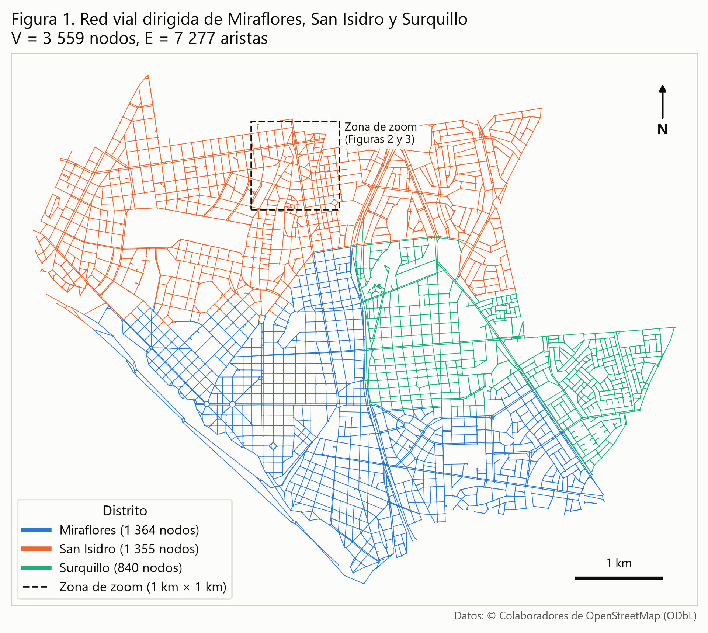
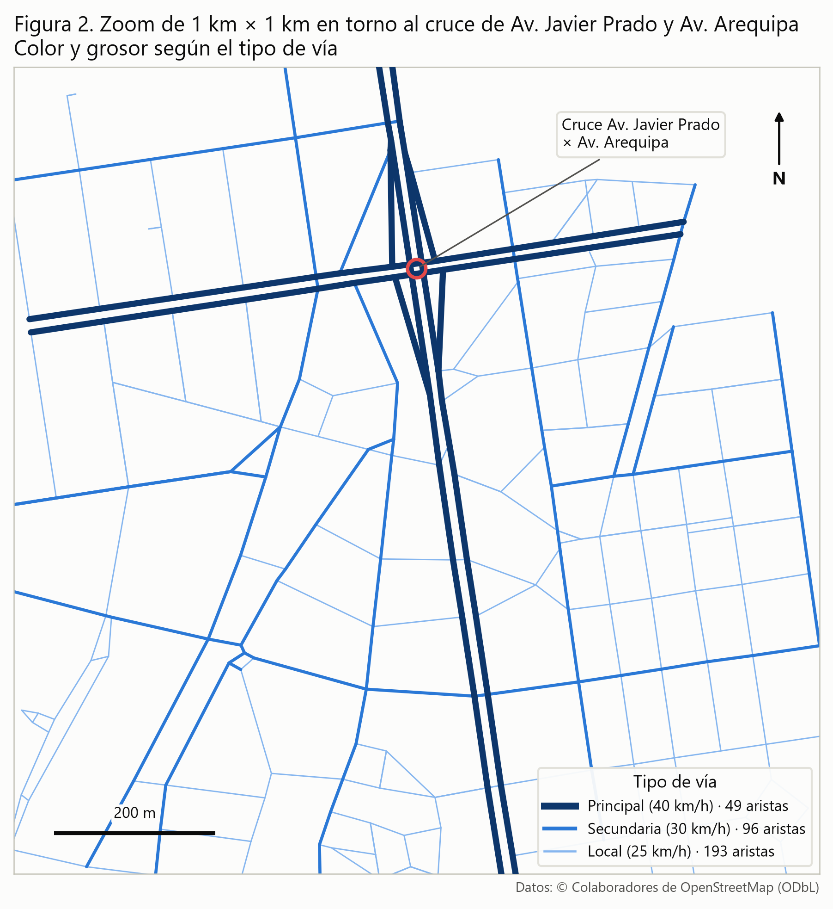
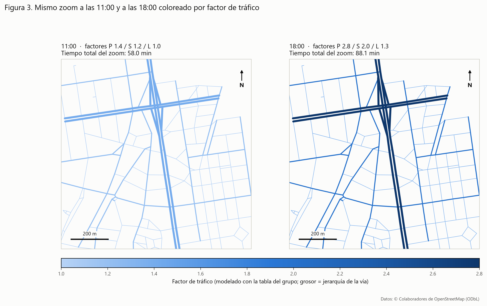

# 2. Descripción del Conjunto de Datos (Dataset)

## 2.1. Origen de los Datos

Los datos provienen de OpenStreetMap (OSM), una base de datos geográfica colaborativa y abierta que cartografía calles, edificaciones y otros elementos del territorio a partir de aportes voluntarios, imágenes satelitales y trazas GPS (OpenStreetMap contributors, 2026). Cada vía se almacena como una secuencia de puntos con coordenadas geográficas y un conjunto de etiquetas; entre ellas, `highway` (jerarquía de la vía), `oneway` (sentido de circulación) y `name` (nombre de la calle).

La red vial se descargó el 21 de septiembre de 2026 con la biblioteca de Python OSMnx, versión 2.1.1 (Boeing, 2017), que consulta la API Overpass de OSM y construye directamente un grafo dirigido. Se usó la función `graph_from_place` con el tipo de red `"drive"`, que conserva solo las vías transitables por vehículos motorizados, para cada uno de los distritos de estudio: Miraflores, San Isidro y Surquillo (Lima, Perú). Los nombres se resolvieron con el formato `"<Distrito>, Lima, Peru"` sin necesidad de variantes. Para no perder las calles que cruzan el límite entre distritos se activó la opción `truncate_by_edge=True`; luego los tres grafos se unieron en un único multigrafo dirigido con NetworkX (Hagberg et al., 2008).

Cada nodo se asignó a un único distrito mediante un criterio geométrico: el distrito cuyo polígono oficial en OSM contiene la coordenada del nodo (en caso de caer exactamente sobre un límite compartido, se asigna al primero en el orden Miraflores, San Isidro y Surquillo; no se presentó ningún caso). Se descartaron 172 nodos situados fuera de los tres polígonos (extremos de calles que continúan hacia distritos vecinos como Lince o San Borja) y 2 nodos que quedaron aislados tras ese recorte. El resultado es una red débilmente conexa (una sola componente).

Los datos de OSM se distribuyen bajo la licencia Open Database License (ODbL) 1.0 (Open Data Commons, s. f.), que permite usarlos, modificarlos y redistribuirlos siempre que se reconozca la fuente y las bases de datos derivadas se compartan bajo la misma licencia. En consecuencia, todas las figuras y archivos derivados de este trabajo llevan la atribución «© Colaboradores de OpenStreetMap».

## 2.2. Motivo del Análisis

El grupo modela el tiempo de viaje en automóvil entre dos puntos de la ciudad, y ese modelo necesita tres datos por cada tramo de calle: su longitud, su sentido de circulación y su tipo de vía. OSM proporciona los tres de forma explícita. Las coordenadas reales de cada intersección permiten calcular la longitud de los tramos. La etiqueta `oneway` indica si el tramo solo puede recorrerse en un sentido, lo que es indispensable en una zona con muchas calles de sentido único. La etiqueta `highway` permite clasificar cada tramo en una de las tres categorías del modelo de pesos del grupo:

- **Principal** (40 km/h): `motorway`, `trunk` y `primary` (incluidas sus variantes `_link`).
- **Secundaria** (30 km/h): `secondary` y `tertiary` (incluidas sus variantes `_link`).
- **Local** (25 km/h): `residential`, `living_street`, `unclassified`, `service` y cualquier otro valor.

Cuando un tramo tiene varios valores de `highway`, se toma el de mayor jerarquía. Como ajuste del modelo, se clasifican como principales todas las aristas de Av. Javier Prado y Av. Arequipa, que el grupo considera avenidas principales. En OSM, Av. Arequipa figura como `secondary` en sus 78 aristas, y 13 de las 96 aristas de Av. Javier Prado (carriles auxiliares de su extremo este) también figuran como `secondary`. En total se reclasificaron 91 aristas, y se verificó que el 100 % de las aristas de ambas avenidas quedara como «principal».

Además, la zona es adecuada porque cumple holgadamente el tamaño mínimo exigido. Se contaron como intersecciones reales los nodos donde confluyen al menos tres calles (`street_count ≥ 3`); los demás nodos son extremos de calles sin salida o puntos intermedios:

| Distrito | Nodos totales | Intersecciones reales (street_count ≥ 3) | ¿≥ 500? |
|---|---:|---:|:---:|
| Miraflores | 1 364 | 1 339 | Sí |
| San Isidro | 1 355 | 1 323 | Sí |
| Surquillo | 840 | 791 | Sí |
| **Total** (mín. 1 500) | 3 559 | 3 453 | Sí |

El requisito (mínimo 1 500 intersecciones en total y 500 por distrito) se cumple tanto contando todos los nodos como contando solo intersecciones reales. Por ello no fue necesario incorporar el distrito de respaldo (Barranco).

## 2.3. Relación con grafos

La red vial se representa como un grafo dirigido y ponderado G = (V, E):

- **Nodo (vértice):** cada intersección de calles (o extremo de una calle sin salida), identificada por su `id` de OSM y sus coordenadas (latitud, longitud).
- **Arista:** cada tramo de calle comprendido entre dos esquinas consecutivas, orientado en el sentido en que puede circular un vehículo.
- **Peso:** el tiempo en minutos necesario para recorrer el tramo, calculado con la fórmula del grupo:

  tiempo (min) = (longitud ÷ velocidad) × factor de tráfico

  donde la velocidad depende del tipo de vía y el factor de tráfico depende del tipo de vía y de la hora, según la siguiente tabla:

| Horario | Principal | Secundaria | Local |
|---|:---:|:---:|:---:|
| 00:00–05:59 | 1,0 | 1,0 | 1,0 |
| 06:00–09:59 | 2,5 | 1,8 | 1,2 |
| 10:00–16:59 | 1,4 | 1,2 | 1,0 |
| 17:00–20:59 | 2,8 | 2,0 | 1,3 |
| 21:00–23:59 | 1,3 | 1,1 | 1,0 |

Como el peso cambia con la hora, el archivo de aristas no guarda un peso fijo, sino la longitud y el tipo de vía; el peso se calcula en el momento de la consulta con la función `peso_minutos(longitud_m, tipo_via, hora)` de `config.py` (Anexo A). Por ejemplo, 500 m de avenida principal toman 1,05 min a las 11:00 y 2,10 min a las 18:00.

La longitud de cada arista se calculó con una implementación propia de la fórmula de Haversine (radio terrestre de 6 371 000 m). Se sumó la distancia entre los puntos consecutivos de la geometría de la calle y, cuando la arista no tiene geometría, se usó la distancia directa entre sus dos nodos. Como validación, estas longitudes se compararon con la columna `length` calculada por OSMnx. La diferencia absoluta promedio fue de 0,0025 m por arista (máximo 0,006 m), y la longitud total de la red fue de 599,330 km, frente a 599,331 km según OSMnx. La mínima diferencia restante se explica porque OSMnx usa un radio terrestre de 6 371 009 m.

El grafo es **dirigido** porque el sentido de circulación restringe los recorridos posibles: una calle de un solo sentido se representa con una única arista (u → v), de modo que no existe el arco inverso (v → u), mientras que una calle de doble sentido se representa con dos aristas opuestas (u → v y v → u) de igual longitud. En el conjunto de datos, el 59,0 % de las aristas corresponde a tramos de un solo sentido y las 2 984 restantes corresponden a calles de doble sentido, representadas como parejas de aristas opuestas. Es un **multigrafo**, porque puede haber más de una arista entre el mismo par de nodos (12 aristas paralelas, p. ej. dos calzadas distintas) y 13 lazos (tramos que salen y regresan a la misma esquina, como retornos o calles en bucle). Su mayor componente fuertemente conexa abarca 3 478 de los 3 559 nodos.

La siguiente tabla resume el conjunto de datos final. Fue generada automáticamente a partir de `datos/nodos.csv` (columnas `id, latitud, longitud, distrito`) y `datos/aristas.csv` (columnas `origen, destino, longitud_m, un_solo_sentido, tipo_via, nombre_calle`):

**Tabla 1**

*Resumen del conjunto de datos*

| Indicador | Valor | % del total |
|---|---:|---:|
| Total de nodos (V) | 3 559 | 100,0 % |
| Total de aristas (E) | 7 277 | 100,0 % |
| Nodos en Miraflores | 1 364 | 38,3 % |
| Nodos en San Isidro | 1 355 | 38,1 % |
| Nodos en Surquillo | 840 | 23,6 % |
| Aristas de vía principal (40 km/h) | 789 | 10,8 % |
| Aristas de vía secundaria (30 km/h) | 1 878 | 25,8 % |
| Aristas de vía local (25 km/h) | 4 610 | 63,4 % |
| Aristas de un solo sentido | 4 293 | 59,0 % |
| Longitud total de las aristas | 599,3 km | — |

*Nota.* Elaboración propia con datos de © Colaboradores de OpenStreetMap, descargados el 21 de septiembre de 2026. En `nombre_calle`, los tramos sin nombre en OSM figuran como «Sin nombre» (362 aristas).

# 3. Visualización del conjunto de datos (Grafo)

Las tres figuras se generan con el script `visualizar.py` (Anexo C), que lee únicamente los archivos CSV del conjunto de datos, sin volver a consultar OSM. Las técnicas empleadas son las siguientes:

- **Lectura y proyección:** los CSV se cargan con pandas y las coordenadas geográficas (WGS 84) se proyectan con pyproj al sistema UTM zona 18 Sur (EPSG:32718), que expresa las posiciones en metros. Así las distancias se conservan en el dibujo y es posible trazar un recuadro exacto de 1 km × 1 km y barras de escala.
- **Dibujo del grafo:** se usa matplotlib (Hunter, 2007). Cada arista se traza como un segmento recto entre sus dos nodos mediante `LineCollection`, que representa el grafo tal como lo verán los algoritmos y no la curvatura real de la calle. Las figuras se exportan en PNG a 300 dpi.
- **Criterio de color:** en la Figura 1 se usa una paleta categórica de tres colores distinguibles por personas con daltonismo (un color por distrito). En la Figura 2 se usa una rampa de un solo tono (azul claro a oscuro) combinada con el grosor de línea para expresar la jerarquía de la vía. En la Figura 3 se usa una rampa continua del mismo tono para el factor de tráfico, normalizada entre el mínimo (1,0) y el máximo (2,8) de la tabla del grupo, de modo que ambos paneles comparten exactamente la misma escala de colores.



*Figura 1.* Red vial dirigida de Miraflores, San Isidro y Surquillo coloreada por distrito. Elaboración propia con datos de © Colaboradores de OpenStreetMap.

La figura muestra el grafo completo: 3 559 nodos y 7 277 aristas, con cada distrito en un color, una barra de escala de 1 km y el recuadro de la zona ampliada en las figuras 2 y 3. Se aprecia la trama en damero de Surquillo y del centro de Miraflores frente a la trama más irregular de San Isidro, así como los grandes ejes viales que estructuran la zona (Vía Expresa, Av. Arequipa, Av. Javier Prado). Las aristas que cruzan el límite entre distritos conectan las tres subredes, por lo que el grafo es una sola componente sobre la que pueden calcularse rutas entre cualquier par de distritos.



*Figura 2.* Zoom de 1 km × 1 km en torno al cruce de Av. Javier Prado y Av. Arequipa, coloreado por tipo de vía. Elaboración propia con datos de © Colaboradores de OpenStreetMap.

Se eligió esta zona de San Isidro porque en ella se cruzan las dos avenidas principales que el grupo usa como referencia, así que en un área pequeña conviven los tres tipos de vía. El cruce (12,09228° S, 77,03334° O) se calculó a partir de los CSV como la intersección geométrica de las aristas de ambas avenidas, porque en OSM es un cruce a desnivel y sus calzadas no comparten ningún nodo. La ventana se desplazó 250 m al sur del cruce porque al norte de Javier Prado comienza Lince, que no forma parte del área de estudio. El recuadro contiene 338 aristas: 49 principales, 96 secundarias y 193 locales. Las avenidas principales aparecen con doble línea porque cada calzada es una arista de un solo sentido.



*Figura 3.* Mismo zoom a las 11:00 y a las 18:00 coloreado según el factor de tráfico del modelo del grupo, con escala de color común. Elaboración propia con datos de © Colaboradores de OpenStreetMap.

El tráfico que muestra esta figura es **modelado** con la tabla de factores del grupo, a través de la función `factor_trafico` de `config.py`, y **no medido en tiempo real**: todas las vías de un mismo tipo reciben el mismo factor a una misma hora. A las 11:00 los factores son 1,4, 1,2 y 1,0 (principal, secundaria y local). A las 18:00 suben a 2,8, 2,0 y 1,3, por eso las avenidas principales pasan al tono más oscuro de la escala. Recorrer una vez cada una de las 338 aristas del zoom (24,7 km) toma 58,0 min a las 11:00 y 88,1 min a las 18:00, un aumento del 51,9 %. El aumento se concentra en las vías principales, cuyo tiempo se multiplica por 2,0 (9,1 → 18,3 min), mientras que en las locales sube solo un 30 % (31,7 → 41,2 min). En hora punta, por tanto, a un algoritmo de ruta más corta le puede convenir desviarse por calles secundarias o locales.

## Anexos

### Anexo A. `config.py`

```python
"""
Configuración compartida del proyecto "Waze para Lima" (TB1 - Complejidad Algorítmica).

Contiene los distritos de estudio, las velocidades base por tipo de vía, la tabla
de factores de tráfico por franja horaria y las funciones para calcular el peso
(tiempo en minutos) de una arista. Solo usa la biblioteca estándar de Python para
que pueda reutilizarse directamente en Dijkstra, Bellman-Ford, etc.
"""

# Distritos de estudio (orden = prioridad para asignar nodos de frontera).
DISTRITOS = ["Miraflores", "San Isidro", "Surquillo"]
DISTRITO_RESPALDO = "Barranco"

# Requisitos mínimos del trabajo.
MIN_INTERSECCIONES_TOTAL = 1500
MIN_INTERSECCIONES_DISTRITO = 500

# Tipos de vía del modelo y su velocidad base (km/h).
TIPOS_VIA = ["principal", "secundaria", "local"]
VELOCIDAD_KMH = {
    "principal": 40,
    "secundaria": 30,
    "local": 25,
}

# Avenidas que el grupo considera "principal" aunque OSM las etiquete con menor
# jerarquía (p. ej. Av. Arequipa figura como highway=secondary en OSM).
# Se aplica a toda arista cuyo nombre empiece con "Avenida <nombre>".
AVENIDAS_PRINCIPALES = ["Javier Prado", "Arequipa"]

# Factor de tráfico por franja horaria: (hora_inicio, hora_fin, {tipo: factor}).
# Las horas son enteras e inclusivas: 6..9 equivale a 06:00-09:59.
FRANJAS_TRAFICO = [
    (0, 5, {"principal": 1.0, "secundaria": 1.0, "local": 1.0}),
    (6, 9, {"principal": 2.5, "secundaria": 1.8, "local": 1.2}),
    (10, 16, {"principal": 1.4, "secundaria": 1.2, "local": 1.0}),
    (17, 20, {"principal": 2.8, "secundaria": 2.0, "local": 1.3}),
    (21, 23, {"principal": 1.3, "secundaria": 1.1, "local": 1.0}),
]


def factor_trafico(tipo_via, hora):
    """Devuelve el factor de tráfico para un tipo de vía a una hora dada.

    tipo_via: "principal", "secundaria" o "local".
    hora: hora del día entre 0 y 23 (se aceptan decimales, p. ej. 18.5 = 18:30).
    """
    if tipo_via not in VELOCIDAD_KMH:
        raise ValueError(f"Tipo de vía desconocido: {tipo_via!r}")
    h = int(hora)
    if not 0 <= h <= 23:
        raise ValueError(f"Hora fuera de rango (0-23): {hora!r}")
    for inicio, fin, factores in FRANJAS_TRAFICO:
        if inicio <= h <= fin:
            return factores[tipo_via]
    raise ValueError(f"Hora sin franja definida: {hora!r}")  # no debería ocurrir


def peso_minutos(longitud_m, tipo_via, hora):
    """Peso de una arista: tiempo en minutos para recorrerla a una hora dada.

    tiempo (min) = (longitud / velocidad) x factor de tráfico
    """
    velocidad_m_por_min = VELOCIDAD_KMH[tipo_via] * 1000 / 60
    return (longitud_m / velocidad_m_por_min) * factor_trafico(tipo_via, hora)


if __name__ == "__main__":
    # Prueba rápida: 1 km de avenida principal a distintas horas.
    for h in (3, 8, 11, 18, 22):
        print(f"{h:02d}:00 -> 1 km principal = {peso_minutos(1000, 'principal', h):.2f} min")
```

### Anexo B. `descargar_red.py`

```python
"""
Descarga la red vial de los distritos de estudio desde OpenStreetMap (OSMnx),
clasifica las vías, calcula longitudes con Haversine, valida los conteos y
exporta datos/nodos.csv y datos/aristas.csv.

Uso:  python descargar_red.py
"""

import json
import math
import os
from collections import Counter
from datetime import datetime

import networkx as nx
import osmnx as ox
import pandas as pd
from shapely.geometry import Point
from shapely.prepared import prep

import config

CARPETA_DATOS = "datos"
RADIO_TIERRA_M = 6_371_000

# Jerarquía de los valores de "highway": mayor número = mayor jerarquía.
JERARQUIA = {"principal": 3, "secundaria": 2, "local": 1}
HIGHWAY_PRINCIPAL = {"motorway", "trunk", "primary"}
HIGHWAY_SECUNDARIA = {"secondary", "tertiary"}


# --------------------------------------------------------------------------
# 1. Descarga
# --------------------------------------------------------------------------
def variantes_nombre(distrito):
    return [
        f"{distrito}, Lima, Peru",
        f"Distrito de {distrito}, Provincia de Lima, Perú",
        f"{distrito}, Provincia de Lima, Lima, Perú",
    ]


def descargar_distrito(distrito):
    """Descarga la red 'drive' de un distrito probando variantes del nombre.

    truncate_by_edge=True conserva las calles que cruzan el límite del distrito
    (sin esto cada distrito queda como una isla desconectada de sus vecinos).
    Devuelve el grafo, el nombre que funcionó y el polígono del distrito.
    """
    for nombre in variantes_nombre(distrito):
        try:
            G = ox.graph_from_place(nombre, network_type="drive", truncate_by_edge=True)
            poligono = ox.geocode_to_gdf(nombre).geometry.iloc[0]
            print(f"  [OK] '{nombre}': {len(G.nodes)} nodos, {len(G.edges)} aristas")
            return G, nombre, poligono
        except Exception as e:  # nombre no resuelto u otro error de geocodificación
            print(f"  [X]  '{nombre}' no funcionó: {e}")
    raise RuntimeError(f"No se pudo descargar el distrito {distrito}")


def construir_grafo(distritos):
    """Descarga cada distrito, asigna distrito a cada nodo y une todo en un MultiDiGraph.

    Criterio de frontera: cada nodo se asigna al distrito cuyo polígono oficial
    (OSM) lo contiene; si cae exactamente sobre el límite de dos polígonos, gana
    el primero según el orden de `distritos`. Los nodos que no caen en ningún
    polígono (extremos de calles que salen hacia Lince, San Borja, etc.) se
    eliminan junto con sus aristas, y también los nodos que quedan aislados.
    """
    grafos, nombres_usados, poligonos = [], {}, {}
    for d in distritos:
        print(f"Descargando {d}...")
        G, nombre, poligono = descargar_distrito(d)
        nombres_usados[d] = nombre
        poligonos[d] = prep(poligono)
        grafos.append(G)
    G = nx.compose_all(grafos)  # sigue siendo MultiDiGraph dirigido

    distrito_de, en_limite, fuera = {}, 0, []
    for n, datos in G.nodes(data=True):
        punto = Point(datos["x"], datos["y"])
        contenedores = [d for d in distritos if poligonos[d].covers(punto)]
        if not contenedores:
            fuera.append(n)
            continue
        en_limite += len(contenedores) > 1
        distrito_de[n] = contenedores[0]
    G.remove_nodes_from(fuera)
    aislados = list(nx.isolates(G))  # esquinas cuyas calles salían todas del área
    G.remove_nodes_from(aislados)
    nx.set_node_attributes(G, distrito_de, "distrito")
    # street_count lo calcula OSMnx antes de recortar, así que refleja las calles
    # reales que llegan a cada esquina (incluidas las que salen del área).
    print(f"Grafo unido: {len(G.nodes)} nodos, {len(G.edges)} aristas "
          f"({len(fuera)} nodos fuera del área y {len(aislados)} aislados eliminados, "
          f"{en_limite} nodos en límite compartido)")
    return G, nombres_usados, {"fuera_eliminados": len(fuera), "aislados_eliminados": len(aislados),
                               "en_limite": en_limite}


# --------------------------------------------------------------------------
# 2. Clasificación de vías
# --------------------------------------------------------------------------
def clasificar_valor(highway):
    base = highway.replace("_link", "")
    if base in HIGHWAY_PRINCIPAL:
        return "principal"
    if base in HIGHWAY_SECUNDARIA:
        return "secundaria"
    return "local"  # residential, living_street, unclassified, service y otros


def clasificar_via(highway):
    """Tipo de vía del modelo; si 'highway' es lista, se toma la de mayor jerarquía."""
    valores = highway if isinstance(highway, list) else [highway]
    tipos = [clasificar_valor(str(v)) for v in valores if v is not None]
    return max(tipos, key=JERARQUIA.get) if tipos else "local"


def es_avenida_principal(name):
    """True si algún nombre de la arista empieza con 'Avenida <X>' para X en
    config.AVENIDAS_PRINCIPALES (ajuste del grupo sobre la etiqueta de OSM)."""
    nombres = name if isinstance(name, list) else [name]
    return any(isinstance(n, str) and n.lower().startswith(f"avenida {a.lower()}")
               for n in nombres for a in config.AVENIDAS_PRINCIPALES)


# --------------------------------------------------------------------------
# 3. Haversine
# --------------------------------------------------------------------------
def haversine(lat1, lon1, lat2, lon2):
    """Distancia en metros sobre la esfera entre dos puntos (grados decimales)."""
    p1, p2 = math.radians(lat1), math.radians(lat2)
    dp = p2 - p1
    dl = math.radians(lon2 - lon1)
    a = math.sin(dp / 2) ** 2 + math.cos(p1) * math.cos(p2) * math.sin(dl / 2) ** 2
    return 2 * RADIO_TIERRA_M * math.asin(math.sqrt(a))


def longitud_arista(G, u, v, datos):
    """Suma Haversine entre puntos consecutivos de la geometría (o u->v si no hay)."""
    if "geometry" in datos:
        puntos = [(lat, lon) for lon, lat in datos["geometry"].coords]
    else:
        puntos = [(G.nodes[u]["y"], G.nodes[u]["x"]), (G.nodes[v]["y"], G.nodes[v]["x"])]
    return sum(haversine(*puntos[i], *puntos[i + 1]) for i in range(len(puntos) - 1))


# --------------------------------------------------------------------------
# 4. Construcción de tablas
# --------------------------------------------------------------------------
def a_booleano(oneway):
    if isinstance(oneway, list):
        return any(a_booleano(o) for o in oneway)
    if isinstance(oneway, str):
        return oneway.lower() in ("yes", "true", "1", "-1")
    return bool(oneway)


def nombre_calle(name):
    if isinstance(name, list):
        return " / ".join(str(n) for n in name)
    if name is None or (isinstance(name, float) and math.isnan(name)) or name == "":
        return "Sin nombre"
    return str(name)


def tablas(G):
    nodos = pd.DataFrame(
        [(n, d["y"], d["x"], d["distrito"], d["street_count"]) for n, d in G.nodes(data=True)],
        columns=["id", "latitud", "longitud", "distrito", "street_count"],
    )
    filas = []
    for u, v, d in G.edges(data=True):
        tipo_osm = clasificar_via(d.get("highway", "unclassified"))
        tipo = "principal" if es_avenida_principal(d.get("name")) else tipo_osm
        filas.append({
            "origen": u,
            "destino": v,
            "longitud_m": round(longitud_arista(G, u, v, d), 2),
            "un_solo_sentido": a_booleano(d.get("oneway", False)),
            "tipo_via": tipo,
            "tipo_via_osm": tipo_osm,
            "nombre_calle": nombre_calle(d.get("name")),
            "highway_osm": d.get("highway"),
            "length_osmnx": d.get("length"),
        })
    return nodos, pd.DataFrame(filas)


# --------------------------------------------------------------------------
# 5. Verificaciones
# --------------------------------------------------------------------------
def verificar_avenidas(aristas):
    resultado = {}
    for avenida in ("Javier Prado", "Arequipa"):
        sel = aristas[aristas["nombre_calle"].str.contains(rf"\bAvenida {avenida}", case=False)]
        conteo_osm = sel["tipo_via_osm"].value_counts().to_dict()
        conteo = sel["tipo_via"].value_counts().to_dict()
        print(f"\nAv. {avenida}: {len(sel)} aristas "
              f"(nombres: {sorted(sel['nombre_calle'].unique())})")
        print(f"  solo con 'highway' de OSM: {conteo_osm}")
        for (hw, nom), k in Counter(zip(sel.loc[sel["tipo_via_osm"] != "principal", "highway_osm"].astype(str),
                                         sel.loc[sel["tipo_via_osm"] != "principal", "nombre_calle"])).most_common():
            print(f"    {k:3d} x highway={hw}  '{nom}'  (reclasificada por AVENIDAS_PRINCIPALES)")
        print(f"  clasificación final:       {conteo}")
        ok = len(sel) > 0 and (sel["tipo_via"] == "principal").all()
        print(f"  => Av. {avenida} sale como 'principal': {'SÍ' if ok else 'NO'}")
        resultado[avenida] = {"aristas": len(sel), "por_tipo_osm": conteo_osm,
                              "por_tipo_final": conteo, "principal_ok": bool(ok)}
    return resultado


def validar_haversine(aristas):
    dif = (aristas["longitud_m"] - aristas["length_osmnx"]).abs()
    rel = dif / aristas["length_osmnx"].where(aristas["length_osmnx"] > 0)
    res = {
        "dif_media_m": round(float(dif.mean()), 4),
        "dif_max_m": round(float(dif.max()), 4),
        "dif_relativa_media_pct": round(float(rel.mean() * 100), 4),
        "longitud_total_haversine_km": round(float(aristas["longitud_m"].sum() / 1000), 3),
        "longitud_total_osmnx_km": round(float(aristas["length_osmnx"].sum() / 1000), 3),
    }
    print("\nValidación Haversine vs. 'length' de OSMnx:")
    print(f"  diferencia absoluta promedio: {res['dif_media_m']} m "
          f"(máx. {res['dif_max_m']} m, relativa {res['dif_relativa_media_pct']} %)")
    print(f"  longitud total: Haversine {res['longitud_total_haversine_km']} km vs "
          f"OSMnx {res['longitud_total_osmnx_km']} km")
    return res


def conteos(nodos):
    tabla = nodos.groupby("distrito").agg(
        nodos_totales=("id", "size"),
        intersecciones=("street_count", lambda s: int((s >= 3).sum())),
    )
    tabla.loc["TOTAL"] = tabla.sum()
    return tabla


def cumple(tabla, columna):
    por_distrito = tabla.drop("TOTAL")[columna]
    return (tabla.loc["TOTAL", columna] >= config.MIN_INTERSECCIONES_TOTAL
            and (por_distrito >= config.MIN_INTERSECCIONES_DISTRITO).all())


def imprimir_validacion(tabla):
    print("\nValidación de conteos (mín. "
          f"{config.MIN_INTERSECCIONES_TOTAL} total, {config.MIN_INTERSECCIONES_DISTRITO} por distrito):")
    print(tabla.to_string())
    for col, desc in (("nodos_totales", "nodos totales"),
                      ("intersecciones", "intersecciones reales (street_count >= 3)")):
        print(f"  Con {desc}: {'CUMPLE' if cumple(tabla, col) else 'NO CUMPLE'}")
        bajos = tabla.drop("TOTAL")[tabla.drop("TOTAL")[col] < config.MIN_INTERSECCIONES_DISTRITO]
        if len(bajos):
            print(f"    distritos bajo {config.MIN_INTERSECCIONES_DISTRITO}: {bajos[col].to_dict()}")


# --------------------------------------------------------------------------
# Programa principal
# --------------------------------------------------------------------------
def main():
    os.makedirs(CARPETA_DATOS, exist_ok=True)
    fecha = datetime.now()

    distritos = list(config.DISTRITOS)
    G, nombres_usados, compartidos = construir_grafo(distritos)
    nodos, aristas = tablas(G)
    tabla = conteos(nodos)
    imprimir_validacion(tabla)

    # Criterio oficial: intersecciones reales. Si no se cumple, se agrega Barranco.
    if not cumple(tabla, "intersecciones"):
        print(f"\nNo se cumple el requisito: se agrega {config.DISTRITO_RESPALDO} y se regenera.")
        distritos.append(config.DISTRITO_RESPALDO)
        G, nombres_usados, compartidos = construir_grafo(distritos)
        nodos, aristas = tablas(G)
        tabla = conteos(nodos)
        imprimir_validacion(tabla)
        if not cumple(tabla, "intersecciones"):
            print("\nATENCIÓN: aun con el distrito de respaldo el requisito NO se cumple "
                  "(ver distritos bajo el mínimo arriba). No se fuerza el resultado.")

    avenidas = verificar_avenidas(aristas)
    haversine_val = validar_haversine(aristas)

    # Exportación (UTF-8) con las columnas pedidas.
    nodos[["id", "latitud", "longitud", "distrito"]].to_csv(
        os.path.join(CARPETA_DATOS, "nodos.csv"), index=False, encoding="utf-8")
    aristas[["origen", "destino", "longitud_m", "un_solo_sentido", "tipo_via",
             "nombre_calle"]].to_csv(
        os.path.join(CARPETA_DATOS, "aristas.csv"), index=False, encoding="utf-8")

    V, E = len(nodos), len(aristas)
    paralelas = E - len(set(zip(aristas["origen"], aristas["destino"])))
    lazos = int((aristas["origen"] == aristas["destino"]).sum())
    n_debiles = nx.number_weakly_connected_components(G)
    mayor_fuerte = len(max(nx.strongly_connected_components(G), key=len))

    metadatos = {
        "fecha_descarga": fecha.strftime("%Y-%m-%d"),
        "hora_descarga": fecha.strftime("%H:%M"),
        "osmnx_version": ox.__version__,
        "networkx_version": nx.__version__,
        "distritos": distritos,
        "nombres_usados": nombres_usados,
        "frontera": compartidos,
        "criterio_frontera": "polígono del distrito que contiene al nodo; en empate, el primero de la lista",
        "componentes_debiles": n_debiles,
        "mayor_componente_fuerte": mayor_fuerte,
        "conteos": tabla.astype(int).to_dict(orient="index"),
        "cumple_nodos_totales": bool(cumple(tabla, "nodos_totales")),
        "cumple_intersecciones": bool(cumple(tabla, "intersecciones")),
        "verificacion_avenidas": avenidas,
        "aristas_reclasificadas_por_nombre": int((aristas["tipo_via"] != aristas["tipo_via_osm"]).sum()),
        "validacion_haversine": haversine_val,
        "V": V, "E": E, "aristas_paralelas": paralelas, "lazos": lazos,
    }
    with open(os.path.join(CARPETA_DATOS, "metadatos.json"), "w", encoding="utf-8") as f:
        json.dump(metadatos, f, ensure_ascii=False, indent=2, default=str)

    print("\n" + "=" * 50)
    print("PARA JOEL")
    print("=" * 50)
    print(f"  Distritos: {', '.join(distritos)}")
    print(f"  V (nodos)   = {V}")
    print(f"  E (aristas) = {E}")
    print(f"  (incluye {paralelas} aristas paralelas u->v adicionales y {lazos} lazos u->u)")
    print(f"  Componentes débilmente conexas: {n_debiles}; "
          f"mayor componente fuertemente conexa: {mayor_fuerte} nodos")
    print(f"  Archivos: {CARPETA_DATOS}/nodos.csv, {CARPETA_DATOS}/aristas.csv")
    print("=" * 50)


if __name__ == "__main__":
    main()
```

### Anexo C. `visualizar.py`

```python
"""
Genera las figuras de la Sección 3 leyendo SOLO datos/nodos.csv y datos/aristas.csv
(no vuelve a descargar nada de OpenStreetMap).

  figuras/figura1.png  Grafo completo coloreado por distrito.
  figuras/figura2.png  Zoom de 1 km x 1 km coloreado por tipo de vía.
  figuras/figura3.png  El mismo zoom a las 11:00 y a las 18:00 según el factor de tráfico.

Las coordenadas se proyectan a UTM zona 18S (EPSG:32718) para trabajar en metros.
Cada arista se dibuja como un segmento recto entre sus dos nodos.

Uso:  python visualizar.py
"""

import json
import os

import matplotlib

matplotlib.use("Agg")
import matplotlib.pyplot as plt
import numpy as np
import pandas as pd
from matplotlib.collections import LineCollection
from matplotlib.colors import LinearSegmentedColormap, Normalize
from matplotlib.lines import Line2D
from matplotlib.patches import Rectangle
from pyproj import Transformer

import config

CARPETA_DATOS = "datos"
CARPETA_FIGURAS = "figuras"
DPI = 300

LADO_ZOOM_M = 1000
# La ventana se centra 250 m al sur del cruce: al norte de Javier Prado empieza
# Lince, que está fuera del área de estudio y dejaría media ventana vacía.
DESPLAZAMIENTO_SUR_M = 250
HORAS_COMPARADAS = (11, 18)

# Paleta (categórica validada para daltonismo en sus 3 primeros colores y
# rampa secuencial azul de claro a oscuro).
FONDO = "#fcfcfb"
TINTA = "#0b0b0b"
TINTA_SECUNDARIA = "#52514e"
COLOR_DISTRITO = ["#2a78d6", "#eb6834", "#1baf7a", "#eda100"]
COLOR_TIPO = {"local": "#86b6ef", "secundaria": "#2a78d6", "principal": "#0d366b"}
GROSOR_TIPO = {"local": 0.7, "secundaria": 1.6, "principal": 3.2}
RAMPA_TRAFICO = LinearSegmentedColormap.from_list(
    "trafico", ["#b7d3f6", "#6da7ec", "#2a78d6", "#1c5cab", "#0d366b"])

plt.rcParams.update({
    "font.family": "sans-serif",
    "font.sans-serif": ["Segoe UI", "DejaVu Sans", "Arial"],
    "figure.facecolor": FONDO,
    "axes.facecolor": FONDO,
    "text.color": TINTA,
})


# --------------------------------------------------------------------------
# Carga y proyección
# --------------------------------------------------------------------------
def cargar():
    nodos = pd.read_csv(os.path.join(CARPETA_DATOS, "nodos.csv"), encoding="utf-8")
    aristas = pd.read_csv(os.path.join(CARPETA_DATOS, "aristas.csv"), encoding="utf-8")
    a_utm = Transformer.from_crs("EPSG:4326", "EPSG:32718", always_xy=True)
    nodos["x"], nodos["y"] = a_utm.transform(nodos["longitud"].values, nodos["latitud"].values)
    pos = nodos.set_index("id")[["x", "y", "distrito"]]
    aristas = aristas.join(pos[["x", "y"]], on="origen").join(
        pos[["x", "y"]], on="destino", rsuffix="_d")
    aristas["distrito"] = aristas["origen"].map(pos["distrito"])
    aristas["xm"] = (aristas["x"] + aristas["x_d"]) / 2
    aristas["ym"] = (aristas["y"] + aristas["y_d"]) / 2
    return nodos, aristas


def miles(n):
    return f"{n:,}".replace(",", "\u00a0")  # 3 559 con espacio no separable


def segmentos(df):
    return np.stack([df[["x", "y"]].values, df[["x_d", "y_d"]].values], axis=1)


def cruce_avenidas(aristas):
    """Punto donde se cruzan Av. Javier Prado y Av. Arequipa, calculado desde los CSV.

    En ese cruce Javier Prado pasa a desnivel, así que las calzadas no comparten
    nodo: se busca la intersección geométrica de sus segmentos y se promedian
    los puntos de cruce (una avenida con dos calzadas produce varios).
    """
    jp = aristas[aristas["nombre_calle"].str.contains("Avenida Javier Prado", case=False)]
    aq = aristas[aristas["nombre_calle"].str.contains("Avenida Arequipa", case=False)]
    p, r = jp[["x", "y"]].values, jp[["x_d", "y_d"]].values - jp[["x", "y"]].values
    q, t = aq[["x", "y"]].values, aq[["x_d", "y_d"]].values - aq[["x", "y"]].values
    cruz = lambda a, b: a[..., 0] * b[..., 1] - a[..., 1] * b[..., 0]
    den = cruz(r[:, None], t[None, :])
    qp = q[None, :] - p[:, None]
    with np.errstate(divide="ignore", invalid="ignore"):
        u = cruz(qp, t[None, :]) / den
        v = cruz(qp, r[:, None]) / den
    i, j = np.where((den != 0) & (u >= 0) & (u <= 1) & (v >= 0) & (v <= 1))
    puntos = p[i] + u[i, j][:, None] * r[i]
    return float(puntos[:, 0].mean()), float(puntos[:, 1].mean()), len(puntos)


def en_ventana(aristas, cx, cy, lado):
    m = lado / 2
    return aristas[(aristas["xm"].between(cx - m, cx + m)) & (aristas["ym"].between(cy - m, cy + m))]


# --------------------------------------------------------------------------
# Elementos comunes
# --------------------------------------------------------------------------
def preparar_ejes(ax, xlim=None, ylim=None):
    ax.set_aspect("equal")
    if xlim:
        ax.set_xlim(*xlim)
        ax.set_ylim(*ylim)
    ax.set_xticks([])
    ax.set_yticks([])
    for s in ax.spines.values():
        s.set_color("#c3c2b7")
        s.set_linewidth(0.6)


def barra_escala(ax, metros, texto, derecha=False):
    x0, x1 = ax.get_xlim()
    y0, y1 = ax.get_ylim()
    bx = x1 - 0.05 * (x1 - x0) - metros if derecha else x0 + 0.05 * (x1 - x0)
    by = y0 + 0.05 * (y1 - y0)
    ax.plot([bx, bx + metros], [by, by], color=TINTA, lw=2, solid_capstyle="butt", zorder=8)
    ax.text(bx + metros / 2, by + 0.015 * (y1 - y0), texto, ha="center", va="bottom",
            fontsize=8, color=TINTA, bbox=dict(boxstyle="round,pad=0.15", fc=FONDO, ec="none"))


def flecha_norte(ax):
    ax.annotate("N", xy=(0.95, 0.95), xytext=(0.95, 0.86), xycoords="axes fraction",
                ha="center", va="center", fontsize=9, fontweight="bold", color=TINTA,
                arrowprops=dict(arrowstyle="-|>", color=TINTA, lw=1.2))


def dibujar_por_tipo(ax, sel, colores):
    """Dibuja las aristas de menor a mayor jerarquía (las principales quedan encima)."""
    for tipo in ("local", "secundaria", "principal"):
        t = sel[sel["tipo_via"] == tipo]
        c = colores[tipo] if isinstance(colores, dict) else colores.loc[t.index]
        ax.add_collection(LineCollection(segmentos(t), colors=c, linewidths=GROSOR_TIPO[tipo],
                                         capstyle="round", zorder=JERARQUIA_Z[tipo]))


JERARQUIA_Z = {"local": 1, "secundaria": 2, "principal": 3}


def atribucion(ax, y=-0.01):
    """Atribución exigida por la licencia ODbL de OpenStreetMap (bajo el eje dado)."""
    ax.text(1, y, "Datos: © Colaboradores de OpenStreetMap (ODbL)", transform=ax.transAxes,
            ha="right", va="top", fontsize=7, color=TINTA_SECUNDARIA)


# --------------------------------------------------------------------------
# Figuras
# --------------------------------------------------------------------------
def figura1(nodos, aristas, ventana):
    fig, ax = plt.subplots(figsize=(8, 7.2))
    distritos = list(dict.fromkeys(config.DISTRITOS + sorted(nodos["distrito"].unique())))
    distritos = [d for d in distritos if d in set(nodos["distrito"])]
    manijas = []
    for i, d in enumerate(distritos):
        color = COLOR_DISTRITO[i]
        sub = aristas[aristas["distrito"] == d]
        ax.add_collection(LineCollection(segmentos(sub), colors=color, linewidths=0.45))
        nd = nodos[nodos["distrito"] == d]
        ax.scatter(nd["x"], nd["y"], s=0.6, color=color, linewidths=0)
        manijas.append(Line2D([], [], color=color, lw=3,
                              label=f"{d} ({miles(len(nd))} nodos)"))
    cx, cy = ventana
    ax.add_patch(Rectangle((cx - LADO_ZOOM_M / 2, cy - LADO_ZOOM_M / 2), LADO_ZOOM_M, LADO_ZOOM_M,
                           fill=False, edgecolor=TINTA, lw=1.1, ls="--", zorder=5))
    ax.text(cx + LADO_ZOOM_M / 2 + 60, cy + LADO_ZOOM_M / 2, "Zona de zoom\n(Figuras 2 y 3)",
            fontsize=7.5, color=TINTA, va="top", zorder=5,
            bbox=dict(boxstyle="round,pad=0.2", fc=FONDO, ec="none", alpha=0.9))
    manijas.append(Line2D([], [], color=TINTA, lw=1.1, ls="--", label="Zona de zoom (1 km × 1 km)"))
    margen = 250
    preparar_ejes(ax, (nodos["x"].min() - margen, nodos["x"].max() + margen),
                  (nodos["y"].min() - margen, nodos["y"].max() + margen))
    barra_escala(ax, 1000, "1 km", derecha=True)
    flecha_norte(ax)
    ax.legend(handles=manijas, loc="lower left", frameon=True, fontsize=8.5,
              title="Distrito", title_fontsize=9, facecolor=FONDO, edgecolor="#e1e0d9")
    ax.set_title("Figura 1. Red vial dirigida de Miraflores, San Isidro y Surquillo\n"
                 f"V = {miles(len(nodos))} nodos, E = {miles(len(aristas))} aristas",
                 fontsize=11, loc="left")
    atribucion(ax)
    fig.savefig(os.path.join(CARPETA_FIGURAS, "figura1.png"), dpi=DPI, bbox_inches="tight")
    plt.close(fig)


def figura2(zoom, cx, cy, cruce):
    m = LADO_ZOOM_M / 2
    fig, ax = plt.subplots(figsize=(7.5, 8))
    dibujar_por_tipo(ax, zoom, COLOR_TIPO)
    preparar_ejes(ax, (cx - m, cx + m), (cy - m, cy + m))
    kx, ky = cruce
    ax.scatter([kx], [ky], s=90, facecolor="none", edgecolor="#e34948", lw=1.8, zorder=6)
    ax.annotate("Cruce Av. Javier Prado\n× Av. Arequipa", xy=(kx, ky), xytext=(kx + 180, ky + 150),
                fontsize=8.5, color=TINTA, zorder=7, ha="left",
                arrowprops=dict(arrowstyle="-", color=TINTA_SECUNDARIA, lw=0.8),
                bbox=dict(boxstyle="round,pad=0.3", fc=FONDO, ec="#e1e0d9"))
    barra_escala(ax, 200, "200 m")
    flecha_norte(ax)
    conteo = zoom["tipo_via"].value_counts()
    manijas = [Line2D([], [], color=COLOR_TIPO[t], lw=GROSOR_TIPO[t] + 0.4,
                      label=f"{t.capitalize()} ({config.VELOCIDAD_KMH[t]} km/h) · {conteo.get(t, 0)} aristas")
               for t in ("principal", "secundaria", "local")]
    ax.legend(handles=manijas, loc="lower right", fontsize=8, title="Tipo de vía",
              title_fontsize=9, facecolor=FONDO, edgecolor="#e1e0d9", framealpha=0.95)
    ax.set_title("Figura 2. Zoom de 1 km × 1 km en torno al cruce de Av. Javier Prado y Av. Arequipa\n"
                 "Color y grosor según el tipo de vía", fontsize=11, loc="left")
    atribucion(ax)
    fig.savefig(os.path.join(CARPETA_FIGURAS, "figura2.png"), dpi=DPI, bbox_inches="tight")
    plt.close(fig)


def figura3(zoom, cx, cy):
    m = LADO_ZOOM_M / 2
    todos = [f for _, _, fs in config.FRANJAS_TRAFICO for f in fs.values()]
    norma = Normalize(vmin=min(todos), vmax=max(todos))  # misma escala en ambos paneles
    fig, ejes = plt.subplots(1, 2, figsize=(12, 6.8))
    resumen = {}
    for ax, hora in zip(ejes, HORAS_COMPARADAS):
        factores = zoom["tipo_via"].map(lambda t: config.factor_trafico(t, hora))
        colores = pd.Series([RAMPA_TRAFICO(norma(f)) for f in factores], index=zoom.index)
        dibujar_por_tipo(ax, zoom, colores)
        preparar_ejes(ax, (cx - m, cx + m), (cy - m, cy + m))
        barra_escala(ax, 200, "200 m")
        flecha_norte(ax)
        minutos = sum(config.peso_minutos(l, t, hora)
                      for l, t in zip(zoom["longitud_m"], zoom["tipo_via"]))
        resumen[hora] = minutos
        fs = {t: config.factor_trafico(t, hora) for t in ("principal", "secundaria", "local")}
        ax.set_title(f"{hora:02d}:00  ·  factores P {fs['principal']} / S {fs['secundaria']} / "
                     f"L {fs['local']}\nTiempo total del zoom: {minutos:.1f} min",
                     fontsize=10, loc="left")
    barra = fig.colorbar(plt.cm.ScalarMappable(norm=norma, cmap=RAMPA_TRAFICO), ax=ejes,
                         orientation="horizontal", fraction=0.05, pad=0.04, aspect=45)
    barra.set_label("Factor de tráfico (modelado con la tabla del grupo; grosor = jerarquía de la vía)",
                    fontsize=9, color=TINTA)
    barra.ax.tick_params(labelsize=8, colors=TINTA_SECUNDARIA)
    fig.suptitle("Figura 3. Mismo zoom a las 11:00 y a las 18:00 coloreado por factor de tráfico",
                 fontsize=12, x=0.02, ha="left")
    atribucion(barra.ax, y=-3.2)
    fig.savefig(os.path.join(CARPETA_FIGURAS, "figura3.png"), dpi=DPI, bbox_inches="tight")
    plt.close(fig)
    return resumen


def main():
    os.makedirs(CARPETA_FIGURAS, exist_ok=True)
    nodos, aristas = cargar()
    kx, ky, n_cruces = cruce_avenidas(aristas)
    cx, cy = kx, ky - DESPLAZAMIENTO_SUR_M
    zoom = en_ventana(aristas, cx, cy, LADO_ZOOM_M)

    figura1(nodos, aristas, (cx, cy))
    figura2(zoom, cx, cy, (kx, ky))
    tiempos = figura3(zoom, cx, cy)

    a_geo = Transformer.from_crs("EPSG:32718", "EPSG:4326", always_xy=True)
    lon, lat = a_geo.transform(cx, cy)
    klon, klat = a_geo.transform(kx, ky)
    h1, h2 = HORAS_COMPARADAS
    por_tipo = {}
    for t in ("principal", "secundaria", "local"):
        sub = zoom[zoom["tipo_via"] == t]
        por_tipo[t] = {
            "aristas": int(len(sub)),
            "longitud_km": round(float(sub["longitud_m"].sum() / 1000), 3),
            **{f"min_{h:02d}": round(sum(config.peso_minutos(l, t, h) for l in sub["longitud_m"]), 2)
               for h in HORAS_COMPARADAS},
        }
    stats = {
        "cruce": {"latitud": round(klat, 6), "longitud": round(klon, 6),
                  "puntos_de_cruce_de_calzadas": n_cruces},
        "centro_zoom": {"latitud": round(lat, 6), "longitud": round(lon, 6)},
        "desplazamiento_sur_m": DESPLAZAMIENTO_SUR_M,
        "lado_zoom_m": LADO_ZOOM_M,
        "aristas_zoom": int(len(zoom)),
        "longitud_zoom_km": round(float(zoom["longitud_m"].sum() / 1000), 3),
        "distritos_zoom": zoom["distrito"].value_counts().to_dict(),
        f"min_total_{h1:02d}": round(tiempos[h1], 2),
        f"min_total_{h2:02d}": round(tiempos[h2], 2),
        "aumento_pct": round((tiempos[h2] / tiempos[h1] - 1) * 100, 1),
        "por_tipo": por_tipo,
    }
    with open(os.path.join(CARPETA_DATOS, "estadisticas_figuras.json"), "w", encoding="utf-8") as f:
        json.dump(stats, f, ensure_ascii=False, indent=2)

    print(f"Cruce Javier Prado x Arequipa: {klat:.6f}, {klon:.6f}; centro del zoom: {lat:.6f}, {lon:.6f}")
    print(f"Aristas en el zoom: {len(zoom)}  ({stats['distritos_zoom']})")
    print(f"Tiempo total del zoom: {tiempos[h1]:.1f} min a las {h1}:00 vs "
          f"{tiempos[h2]:.1f} min a las {h2}:00 (+{stats['aumento_pct']} %)")
    print(f"Figuras guardadas en {CARPETA_FIGURAS}/ (figura1.png, figura2.png, figura3.png)")


if __name__ == "__main__":
    main()
```

## Referencias

Boeing, G. (2017). OSMnx: New methods for acquiring, constructing, analyzing, and visualizing complex street networks. *Computers, Environment and Urban Systems, 65*, 126–139. https://doi.org/10.1016/j.compenvurbsys.2017.05.004

Hagberg, A. A., Schult, D. A., & Swart, P. J. (2008). Exploring network structure, dynamics, and function using NetworkX. En G. Varoquaux, T. Vaught, & J. Millman (Eds.), *Proceedings of the 7th Python in Science Conference* (pp. 11–15). https://doi.org/10.25080/TCWV9851

Hunter, J. D. (2007). Matplotlib: A 2D graphics environment. *Computing in Science & Engineering, 9*(3), 90–95. https://doi.org/10.1109/MCSE.2007.55

Open Data Commons. (s. f.). *Open Database License (ODbL) v1.0*. Open Knowledge Foundation. https://opendatacommons.org/licenses/odbl/1-0/

OpenStreetMap contributors. (2026). *OpenStreetMap* [Conjunto de datos]. OpenStreetMap Foundation. Recuperado el 21 de septiembre de 2026, de https://www.openstreetmap.org
